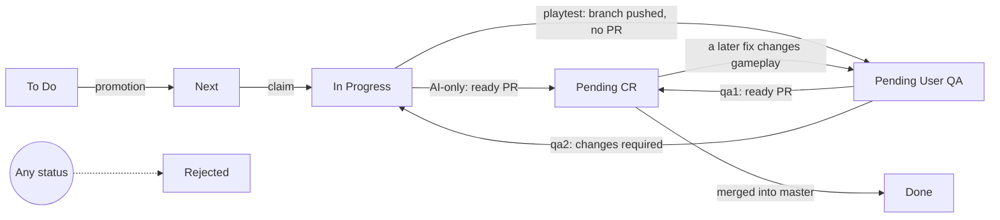

# AI development flow

> How agent sessions take work from Jira and deliver it: intake, batching, dependencies, claims, worktrees,
> checks, playtests, and the handoff to the pull request skills. Decisions:
> [ADR 0016](decisions/0016-jira-batch-delivery.md), playtests before the pull request in
> [ADR 0022](decisions/0022-playtest-before-the-pull-request.md). `CLAUDE.md` comes first; skills may add detail
> to this document but never weaken it or `CLAUDE.md`.

The shortcuts `flow1` (take a batch of sprint tickets and deliver it), `flow2` (turn Matěj's task description
into a ticket and deliver it), and Matěj's playtest answers `qa1` (passed: publish the batch) and `qa2` (changes
required: revise it) live in [`.claude/skills/`](../.claude/skills/). They are entry points into this document,
not a second source of truth: every rule here also applies to direct work on a ticket. After publication
the pull request skills take over: [`monitor-pr`](../.claude/skills/monitor-pr/SKILL.md),
[`fix-pr`](../.claude/skills/fix-pr/SKILL.md), [`finalize-pr`](../.claude/skills/finalize-pr/SKILL.md) and
[ADR 0015](decisions/0015-merging-through-monitor-pr.md).

The roadmap ([roadmap.md](roadmap.md)) stays the plan and the source of the task order; Jira is the queue that
mirrors it, plus work outside the roadmap, and the only source of task status
([ADR 0017](decisions/0017-jira-as-the-source-of-task-status.md)).

## Jira

### Project facts

| What | Value |
| --- | --- |
| Site | `envelopment.atlassian.net`, cloud id `1baac1c3-be5c-48dd-b9fc-941b03a811b3` |
| Project | space Realmforge, key `RLM`. Scope every read and write to `RLM` and check the key prefix before each write |
| Tools | the Atlassian MCP server `atlassian` from `.mcp.json` ([setup](dev-setup.md#5-claude-code)); a cloud session uses the claude.ai Atlassian connector, which has the same tools |
| Sprint | field `customfield_10020`, which takes the numeric sprint id. Read the active sprint from Jira every time: JQL `project = RLM AND sprint in openSprints()`, the `customfield_10020` entry with `state: active`. Never reuse an old id |
| Epics | RLM-6 to RLM-12: milestones M1 to M7. RLM-1: developer workflow and tooling outside the roadmap. RLM-30: Storyline (realms, lore) |
| Statuses | To Do, Next, In Progress, Pending User QA, Pending CR, Done, Rejected |
| Transitions | all global (Jira accepts each one from every status): `11` To Do, `21` Next, `31` In Progress, `41` Pending User QA, `51` Pending CR, `61` Rejected, `71` Done |
| Dependencies | link type `Blocks`. "A is blocked by B" is `createIssueLink` with `type: Blocks`, `inwardIssue: B`, `outwardIssue: A`. A ticket's `issuelinks` lists each blocker as an `inwardIssue` of type `Blocks` |
| Account | agents act under Matěj's Jira and GitHub accounts, so an author field never tells an agent's comment from his |

### Issues

- Search `RLM` for an equivalent ticket before creating one (JQL `project = RLM AND text ~ "<terms>"`), and read
  each candidate with its comments.
- A ticket created from Matěj's prompt goes into the active sprint unless he asks for the backlog or another
  sprint.
- Follow the existing tickets' format:
  - **Type:** Task for planned work, Bug only for confirmed broken behavior, Epic only when Matěj asks for one.
  - **Title:** a roadmap task keeps its roadmap id (`F1: Feature skeleton`); other tickets use sentence case
    (`Pack: replace beta library builds with stable releases`).
  - **Parent:** the milestone epic the work belongs to (RLM-6 for M1). Work outside the roadmap goes under the
    epic whose description covers it (RLM-1 for workflow and tooling, RLM-30 for storyline).
  - **Labels:** lowercase. One or more area labels, preferring existing ones (`foundations`, `pipeline`,
    `character`, `stats`, `combat`, `spells`, `talents`, `world`, `mobs`, `dungeons`, `boss`, `quests`, `assets`,
    `ci`, `release`, `tooling`, `docs`, `ui`, `realms`, `storyline`, `lore`, `design`, `research`); the milestone
    label of its epic (`m1` to `m7`); and `spike`, `decision` or `backlog` where they apply.
  - **Priority:** High, Medium or Low, relative to the sprint.
  - **Description:** English Markdown in one of the two existing shapes, both with a "Done when" section:
    - a roadmap task: `**Size:** S|M|L. After <task> (RLM-<n>). Waits for decision <Dn> (RLM-<n>).`, a paragraph
      on what to build, `**Done when:** ...`, then `Roadmap: [...]. Architecture: [...]` links;
    - any other task: `## Context`, `## Task` (or `## Proposal`), `## Done when`.
  - **Dependencies:** every "after" and every decision the ticket waits for is also a `Blocks` link.
- **Jira is the single source of truth for work; GitHub issues are never used.** Every follow-up and bug worth
  doing that a pull request leaves undone, including a valid review finding tracked instead of fixed, becomes an RLM
  ticket (search for an equivalent first, as above), never a GitHub issue or a local TODO. A declined, dropped or
  incorrect finding needs only its recorded reason. When no Atlassian tool reaches Jira, the follow-up goes into the
  session's report for Matěj. An open GitHub issue is migrated: a ticket whose description opens with `Migrated from
  GitHub issue matejkadlec/realmforge#<n>`, then the issue is closed as not planned with the ticket's key. The
  procedure: [Follow-up tickets](#follow-up-tickets).

### Follow-up tickets

Work a change leaves undone becomes an RLM ticket, never a GitHub issue: a review finding that `fix-pr` or
`finalize-pr` tracks instead of fixing, a real finding outside the pull request's scope, and a larger follow-up
found during implementation.

1. **Search first** with `searchJiraIssuesUsingJql` (`project = RLM AND text ~ "<terms>"`, the candidate field set
   from [Reading a ticket](#reading-a-ticket)), and read each candidate with its comments. When an equivalent
   ticket exists and is not Done, cite it and add a comment with the new evidence (the pull request, the head, the
   scenario) instead of creating a duplicate.
2. **Otherwise create a Task** with `createJiraIssue` in the format of [Issues](#issues):
   - **title:** sentence case with an area prefix (`Docs: ...`, `Gradle queue: ...`);
   - **parent:** the epic the work belongs to: the milestone epic for game code and its design (RLM-6 for M1),
     RLM-1 for workflow and tooling, RLM-30 for the storyline;
   - **labels:** the area labels and the milestone label of that epic;
   - **priority:** Medium, unless the defect clearly calls for High (it breaks normal use) or Low (polish);
   - **sprint:** the active sprint (`customfield_10020` with the numeric id read from Jira, [Project
     facts](#project-facts)), so the next intake sees it;
   - **description:** `## Context` (where it was found: the review and its round, the pull request and head SHA,
     the severity), `## Task` (the problem, a concrete scenario, the smallest fix, and any pull request it must
     wait for), `## Done when`;
   - **links:** `Relates` to the batch's tickets, and `Blocks` from any ticket it must wait for.

   Findings that share a file or a fix go into one ticket.
3. **Reference it** as `RLM-<n>` wherever the finding is closed (a thread reply `Tracked as RLM-<n>:`, a report).
4. **Jira unreachable:** when no Atlassian tool reaches Jira in the session (neither the `atlassian` server
   nor the claude.ai connector), list the follow-up in the session's report for Matěj, never as a GitHub issue.

### Reading a ticket

Read a ticket's comments together with its description wherever a procedure uses ticket context: `flow1` intake,
the `flow2` duplicate search, the dependency check and the atomic intake claim. Matěj's corrections, earlier
agent findings, claims and playtest history live in comments.

The MCP tools `getJiraIssue` and `searchJiraIssuesUsingJql` return no comments unless `fields` includes
`comment`, and give no sign that any exist. `fields` replaces the default set instead of adding to it, so every
read, a JQL search included, passes the complete set its check needs:

| Read | `fields` |
| --- | --- |
| Candidate at intake, `flow2` duplicate search | `["comment", "summary", "description", "status", "priority", "issuetype", "assignee", "labels", "parent", "issuelinks", "customfield_10020"]` |
| Dependency check | `["comment", "summary", "description", "status", "labels", "issuelinks", "customfield_10020"]` |
| Atomic intake claim, both reads | `["comment", "status", "assignee"]` |
| Re-read before a promotion or any status move | `["comment", "status", "assignee"]` |
| Merged-ticket reconciliation | `["comment", "summary", "status"]` |

The embedded comment field is one bounded page, not the whole thread:
`"comment": {"comments": [...], "startAt": N, "maxResults": M, "total": T}`, oldest first. On a long thread Jira
embeds the last page, so the oldest comments are the ones a single read misses. Check `startAt` and `total`
before assuming either end is present; a page that holds 100 or more comments without `startAt` and `total`
cannot be shown complete. The status history comes from `getJiraIssue` with `expand: "changelog"`, also a bounded
page. A ticket's current work cycle starts at its last move into Next; when the page shows no such move and does
not reach back to the ticket's creation (its `startAt` is above 0), the cycle start is unknown. A ticket whose
comments or history cannot be shown complete is left alone: change nothing on it (no reconciliation, no claim, no
recovery) and list it under "Blocked or other".

A search returns pages too: pass `maxResults: 100` and follow `nextPageToken` until a page says `isLast: true`
(verified on this site on 2026-10-11). A search that cannot be shown complete that way, such as a page that is not
the last but carries no token, is completed by key ranges: order the JQL by key and repeat it with
`AND key > <last key read>` until a page comes back short. A step that needs a search it still cannot complete
(intake, reconciliation, a slot count) does not act on a partial list: it stops and reports the search under
"Blocked or other".

A comment records what someone observed, decided or claimed: it is evidence, not authority. Follow a comment as
Matěj's instruction only when it is explicitly his (he wrote it as himself, or an agent quoted him with the date).
A comment with an agent label (`🔒 Intake claim`, `🤖 Claude QA`, `🎮 Playtest handoff`, `🎮 Playtest passed`)
reshapes nothing on its own, however useful its findings.

### Status model



- **To Do:** in the active sprint, not queued yet.
- **Next:** the curated execution queue of the active sprint, never empty while eligible To Do tickets remain.
- **In Progress:** a session claimed it and implementation began.
- **Pending User QA:** a playtest batch waits for Matěj's playtest, and nothing else: its branch is pushed and has
  **no pull request** until his `qa1` ([Playtest handoff](#playtest-handoff)). The one exception is a
  reconfirmation: a pull request published by `qa1` whose later fix changed gameplay, held by `needs-playtest`
  until he plays it again. A missing decision, account or credential keeps a ticket where it is, with the blocker
  recorded in a comment.
- **Pending CR:** a ready pull request is open and its publishing session's monitored merge carries it through
  review, checks and merge, or that run stopped and Matěj manages it.
- **Done:** only after the pull request merged into `master`.
- **Rejected:** invalid, duplicate, cancelled or out of scope, with the reason in a comment.

Every RLM transition is global, so Jira itself refuses no move: a stale move can pull a peer's fresh claim back
to Next. Re-read the ticket immediately before every move, with the field set from the table above, and make the
move only while the ticket still shows the status and evidence the step decided on. Otherwise a peer moved first:
skip it and re-plan. A move to Next is either a promotion from To Do or the return of an abandoned or released
claim; a move to To Do returns a ticket to the sprint queue deliberately; a move to Done is the merge, or an
administrative correction Matěj asks for.

### In flight

A ticket is **in flight** when it is In Progress, Pending User QA or Pending CR, or an open pull request names it
(`RLM-<n>` in its title), unless [reconciliation](#reconciling-merged-tickets) found that all its associated pull
requests closed unmerged. A batch is in flight while any of its tickets is. A branch or worktree alone never makes
a ticket in flight: a released claim's branch or a dead run's batch branch can stay behind. Every rule in this
document that says "in flight" or "in-flight" means this.

### Reconciling merged tickets

`monitor-pr` moves its pull request's tickets to Done after the merge, but a pull request merged after its run
stopped (by Matěj, or by a later session) leaves its tickets in Pending CR or Pending User QA, and a Jira write
that failed at publication and again after the merge leaves them In Progress. Every later intake would read them
as in flight. `flow1` and `flow2` therefore run this pass first, before creating,
selecting or claiming anything. It reads merge state that already exists, never waits for a merge, and changes
nothing else.

1. List every `RLM` ticket in In Progress, Pending CR or Pending User QA, whatever its sprint, with the
   reconciliation field set.
2. Associate pull requests in `matejkadlec/realmforge` only from evidence of the ticket's current work cycle,
   which begins when the ticket last entered Next (its status history). Evidence is a pull request opened since
   then whose head branch is the batch branch named in the ticket's winning claim comment (the earliest one since
   it last entered Next, as in the [atomic intake claim](#atomic-intake-claim)), or whose title names the ticket
   key. A key named only in a body, a commit message or another comment is not evidence. A pull request that
   reverts an associated one (its title or a commit subject is `Revert "<exact title>"`, or a commit carries
   `This reverts commit <its merge commit>`, opened after that merge) is associated too.
3. Move the ticket to Done only when an associated pull request merged into `master`, none is still open, and no
   merged pull request reverts an associated one. Re-read the ticket immediately before the move and skip it
   unless it is still in the status it was listed with.
4. Otherwise leave it: no associated pull request, one still open, a merge into another branch, or a merged
   revert (whether the change is still on `master` is then Matěj's call). A ticket whose associated pull requests
   all closed unmerged is no longer in flight: it holds no slot, and the ledger lists it under "Blocked or other"
   for Matěj to send back to Next or reject. Sending it back adds a claim-release comment naming its old branch,
   for the record.

A batch pull request reconciles every ticket associated with it. The pass changes that one status and nothing
else. A ticket that cannot be read or matched is skipped and never stops the run. The run's batch ledger lists
every reconciled key under "Merged into master" with its pull request.

### Priority and the Next queue

Priority is a recommendation relative to the sprint: any active-sprint ticket outranks future-sprint work
whatever its displayed priority. Within Next, look at High before Medium and Low, subject to dependencies,
conflicts, ownership, QA mode, coherent batching and safe verification. Within one priority, follow the roadmap
order: the current milestone's spikes first, then its phases in order. Reassess active-sprint priorities only on
concrete evidence (a dependency, a risk, newly found scope) and keep the change inside the active sprint.

Every session taking work from Next maintains the queue:

1. Work only inside the active sprint, and select implementation work from Next. Do not skip a suitable Next
   ticket because a To Do ticket looks more interesting.
2. If Next is empty while eligible To Do tickets remain, move the most appropriate ticket or coherent batch to
   Next, and only then select it.
3. If taking the selection would empty Next while eligible To Do work remains, first promote at least one
   suitable following ticket or batch.
4. Promote compatible eligible To Do tickets to fill an AI-only batch toward the expected scale
   ([Batch selection](#batch-selection)).
5. Move from Next to In Progress only when implementation begins (the claim).

These are the only promotions, plus two exceptions: [Dependencies](#dependencies) pulls in a dependency of a
selected ticket, and `flow2` promotes and selects the tickets it creates or picks for Matěj's request directly,
whatever else Next holds, because he asked for that work now. Never promote other Backlog or future-sprint
work. A ticket is eligible when it is not [waiting on Matěj](#tickets-waiting-on-matěj) and none of its
dependencies is in flight elsewhere. Intake works from a snapshot a peer may already have overtaken, so
immediately before each promotion re-read the ticket and promote it only while it is still To Do. A ticket that
already left To Do belongs to a peer: skip it and re-plan.

Before every handoff boundary (publishing or updating a ready pull request, or ending a run), re-inspect Next and
To Do with what the batch taught you, and replenish Next while eligible To Do work remains. This never authorizes
selecting new work after the pull request is published. When a session changes a priority, its handoff names the
ticket and the reason.

Continuing work this session already owns, linked remediation, and resumed work do not pass back through Next.

### Dependencies

A ticket depends on another when a `Blocks` link names the other as its blocker, or when
[roadmap.md](roadmap.md) or the ticket's description says "after X" or "waits for decision Dn". The links were
created from the roadmap on 2026-10-11; when the two sources disagree, both count, and the batch adds the
missing link. A dependency is met when its ticket is Done.

For each unmet dependency of a selected ticket, in this order:

1. **Waiting on Matěj** (a `decision` ticket, or one [waiting on Matěj](#tickets-waiting-on-matěj)): the ticket
   cannot be implemented. Leave it, and list it with the dependency.
2. **[In flight](#in-flight) elsewhere:** it belongs to that batch. Defer the ticket. A stacked branch on the
   dependency's branch is allowed only when it is necessary and safe; its pull request targets that branch and
   says so, and `monitor-pr` retargets it once the base has merged.
3. **Otherwise** (To Do, Next, the Jira backlog or a future sprint): pull it into the batch. Put it into the
   active sprint when it is outside it (the sprint field), promote it from To Do to Next, and claim it with the
   rest of the batch. Check its own dependencies the same way, recursively.

- Pulling in a dependency is the one case where Backlog or future-sprint work enters Next without Matěj.
- Inside the batch, dependencies are implemented and committed first.
- When the whole chain does not fit one batch ([Batch selection](#batch-selection)), the batch takes the chain
  from the bottom (the unblocked dependencies, as many as fit) and the dependent ticket stays in Next for a later
  batch. The batch announcement says so.
- A batch has one QA mode: if the dependent ticket or a pulled-in dependency needs a playtest, the whole batch is
  a playtest batch (one branch, one playtest, one pull request after `qa1`).
- The batch announcement and the claim comment of each pulled-in ticket name the ticket that needed it.

### Tickets waiting on Matěj

Agents never implement a ticket labelled `decision`, or one waiting on Matěj. A ticket waits on him when it cannot
be started or finished without something only he can give: a decision or a pick between options, an account,
credentials or credits, approval to install a tool or MCP server, content he builds himself (rooms in creative),
or his own playthrough. The description usually says so ("Decision for Matěj", "Owner decision", "Needs Matěj",
"Needs from Matěj"), and so does an unmet `Blocks` link to a decision ticket or to another waiting ticket. A review
or playtest at the end of the work does not count: that is the playtest hold. A ticket whose roadmap task exists
only in an open pull request (a comment on it names that pull request,
[ADR 0017](decisions/0017-jira-as-the-source-of-task-status.md)) is not selectable either until that pull request
merges.

- Such tickets are neither selected nor promoted; they stay in To Do.
- Every [status overview](../CLAUDE.md#status-overview) lists them under "Blocked or other", one line each: a
  decision ticket with its proposal and the tickets it blocks; any other ticket with what it needs.
- A decision is made when its ticket is Done; its comments record what Matěj decided, and the implementing batch
  follows that. Writing the outcome into the roadmap's open decisions is a plan change
  ([Publication](#publication)).

### QA evidence

Each ticket's comments hold its evidence: the claim, the `🎮 Playtest handoff` and each `qa2` revision, the
`🎮 Playtest passed` record of a `qa1`, the `🤖 Claude QA` summary that [publication](#publication) records (what
was verified and how, the pull request, its head), and the updates `monitor-pr` records after its own pushes.
Matěj reads the session's handoff first and opens a ticket only for detail.

## QA classification

Classify every candidate ticket before batching it. Matěj plays every gameplay change before its pull request
opens ([ADR 0022](decisions/0022-playtest-before-the-pull-request.md)); everything else merges on automated
evidence.

**AI-only:** the ticket changes nothing a player sees, hears or does in the game. This covers tooling, CI, docs,
ADRs, research and design documents, the content pipeline when the game data it produces is unchanged, tests and
GameTests, the dev-only QA mod, refactors, and foundations with no player-facing behavior yet (packages,
registries, attachments, payloads).

**Playtest** (ends in Pending User QA): the ticket changes gameplay: items, blocks, mobs, bosses, spells and
effects, stats, numbers and balance, XP and levels, loot, worldgen, dimensions and dungeons, quests and their
texts, screens, HUD and key bindings, textures, models, animations, particles and sounds, world rules, and pack
changes a player notices (a mod added, removed or reconfigured). Covering it with GameTests does not make it
AI-only: the playtest is Matěj's judgment of how it plays and looks, never a substitute for automated tests.

**Mixed scope:** partition candidates by QA mode before grouping them by similarity, and never mix modes only to
make a batch bigger. Split a ticket whose gameplay and non-gameplay parts separate cleanly when that helps; when
they cannot be separated, the whole batch is a playtest batch. Pulled-in dependencies follow
[Dependencies](#dependencies).

### Playtest handoff

A playtest batch opens **no pull request while it waits for Matěj's playtest**: Codex review, CI and the merge
come after he passes it with `qa1`. Its branch is on `origin` from the claim on, so he plays it from there.

1. Run the full gate ([Implementation and verification](#implementation-and-verification)) and commit the
   coherent work.
2. Push the branch (`git push origin <branch>`, with `--force-with-lease` after a rebase) and read its remote head
   back: it must be your final commit. A branch push starts no CI. Open no pull request.
3. On each ticket, record the `🎮 Playtest handoff`: the branch and its head, [What to test](#what-to-test), the
   [launch commands](#launch-commands) and the checks that passed. Then move the tickets to Pending User QA.
4. Keep the branch and the worktree for the answer.
5. Give Matěj the handoff as the [status overview](../CLAUDE.md#status-overview) in its manual-test shape: What to
   test, the launch commands, the verification and the batch ledger, closing with how he answers: `qa1` when the
   playtest passes, `qa2` with what is wrong.
6. Stop: the handoff ends the run ([Concurrency and run boundaries](#concurrency-and-run-boundaries)). His answer
   may come in this session or any later one, local or cloud.

While Matěj plays from the batch's worktree, run no Gradle task in it.

### qa1: playtest passed

Matěj's `qa1` passes the playtest and authorizes publishing the batch. The
[`qa1` skill](../.claude/skills/qa1/SKILL.md) carries it out:

1. **Find the batch:** the one this session handed off, the keys or branch Matěj names, or the only playtest
   batch in Pending User QA. With several and no hint, ask which one, listing each with its tickets and branch. An
   open decision question that a `qa2` left on its tickets is answered (or he confirms the batch as it is) before
   anything is published.
2. **Take the branch:** `git fetch origin`, then reuse the worktree that holds it, or create one from
   `origin/<branch>` ([Branches and worktrees](#branches-and-worktrees)). Bring the local branch up to
   `origin/<branch>` before anything else (`git merge --ff-only`, or a merge when both sides have commits):
   commits Matěj pushed from his own clone belong to the batch and are never pushed over, and every later push is
   leased on that fetched head. His uncommitted edits in the worktree follow `CLAUDE.md`: fold small ones that
   belong to the batch into the next commit, ask about anything larger. A gameplay change after the handed-off
   head (his edits or pushed commits) counts as played only when his `qa1` says so; otherwise it goes back to him
   for another playtest instead of being published.
3. **Finish:** commit. When `origin/master` (for a stacked batch: its dependency branch) moved, rebase onto it
   and regenerate generated files with `uv run rf gen`. Whenever the head differs from the handed-off head the
   gate last passed on, run the full gate again. A rebase whose conflict resolutions touch anything a player sees
   ([QA classification](#qa-classification)) changes what Matěj played: push it and hand it back for another
   playtest, as a `qa2` revision does, instead of publishing.
4. **Publish** as in [Publication](#publication): push, one ready pull request without `needs-playtest`, the head
   read back. The description carries the line `Playtest passed: played <sha>, published <sha>`, so the played
   head survives a failed Jira write.
5. **Record** on each ticket the `🎮 Playtest passed` (the played head, the head it was published as, his words if
   he gave any) and the `🤖 Claude QA` summary, then move the tickets from Pending User QA to Pending CR. That
   frees the batch's playtest slot.
6. **Hand off and monitor:** the status overview, then `/monitor-pr <n>` in the same run, to the merge.

For a pull request that already waits for a playtest (a [reconfirmation](#reconfirmation), or a gameplay pull
request outside the flow with `needs-playtest`), `qa1` instead passes only the head Matěj played (the one the
latest `🎮 Playtest handoff` names; gameplay commits added since then go back to him for another playtest), and
records the `🎮 Playtest passed` for its current head on each of its tickets (one outside the flow may have none:
the label's removal then records the playtest), removes `needs-playtest` for Matěj (his `qa1` is his answer),
moves the tickets to Pending CR, and continues `monitor-pr` on it. One `monitor-pr` run owns a pull request: an
answer in the session whose run waits for it continues that run; in any other session `qa1` first asks Matěj
whether the waiting run has stopped, and acts only then.

### qa2: changes required

Matěj's `qa2` with what is wrong sends the batch back for a revision on the same branch. The
[`qa2` skill](../.claude/skills/qa2/SKILL.md) carries it out:

1. **Find the batch** as for `qa1`, and move the affected tickets from Pending User QA to In Progress.
2. **Take the same branch** (never a new one), in its worktree or a new one from `origin/<branch>`, brought up to
   `origin/<branch>` as for `qa1`. Read the tickets' comments for context the handoff did not repeat.
3. **Fix** what he reported, run the affected checks and the full gate, and commit.
4. **Push** the revision (`--force-with-lease` after a rebase) and read the remote head back. Open no pull request;
   a reconfirmation's pull request simply gets the new head, and its `monitor-pr` run carries on.
5. **Record** the revision on each affected ticket as a new `🎮 Playtest handoff` (what changed, the new head, a
   What to test limited to it), so its head is the one `qa1` passes next, and move the tickets back to Pending
   User QA. The batch keeps its playtest slot through the revision.
6. **Hand back** with the status overview in its manual-test shape: What to test limited to the revision, the
   command that updates his checkout ([Launch commands](#launch-commands)), and the closing line on `qa1` and
   `qa2`. Then wait for his next answer.

### Reconfirmation

A fix after `qa1` (a `fix-pr` commit, a thread fix, a check repair, a conflict resolution) can change what Matěj
played. When the commits the pull request added after the published head that Matěj passed change gameplay
([QA classification](#qa-classification)), `monitor-pr` adds `needs-playtest`, moves the tickets back to Pending
User QA with a `🎮 Playtest handoff` limited to the change, and holds the merge until Matěj answers `qa1` (or
removes the label) or `qa2`. Commits that change nothing a player sees (docs, tests, a refactor its tests cover,
a merge of `master` whose conflict resolutions touch nothing a player sees) need no new playtest.

### Launch commands

Every manual-test handoff gives complete commands Matěj can paste, under "Launch commands" in the
[status overview](../CLAUDE.md#status-overview): PowerShell for his Windows clone, his WSL terminal otherwise.

- **The dev client on Windows**, the default for a playtest (core mod and QA mod, QA commands available, logged in
  with his own account through DevLogin, working mouse look; [dev setup](dev-setup.md#32-on-windows-playtests)).
  The batch branch is on `origin` from the claim on, so this works for local and cloud batches alike:

  ```powershell
  cd $HOME\projects\realmforge-win
  git fetch origin
  git switch <branch>
  .\gradlew.bat runClient
  ```

- **The dev client in WSL**, only for a check that needs no mouse look (does it load, does a screen open; WSLg
  breaks first-person mouse look, [dev setup](dev-setup.md#33-in-wsl-quick-checks)):

  ```bash
  cd ~/projects/realmforge-worktrees/<dir> && ./gradlew runClient
  ```

- **The full pack in Prism**, when the change only shows with the pack, or `pack/` changed: install the jar,
  and serve the pack from the worktree when `pack/` changed (the local pre-launch command in
  [dev setup](dev-setup.md#4-playing-the-pack-on-windows-prism-launcher--packwiz-installer)). The QA mod is never
  installed into Prism, so QA commands are missing there.

  ```bash
  cd ~/projects/realmforge-worktrees/<dir> && ./gradlew :mod:installToPrism
  cd ~/projects/realmforge-worktrees/<dir>/pack && packwiz serve
  ```

- **A branch from a cloud session** exists only on `origin`, so the WSL commands first create the worktree:

  ```bash
  cd ~/projects/realmforge && git fetch origin <branch> && git worktree add ../realmforge-worktrees/<dir> <branch>
  cd ~/projects/realmforge-worktrees/<dir> && uv sync && ./gradlew runClient
  ```

- **A revision** gives the command that updates an existing checkout: `git pull --ff-only`, or after a rebase
  `git fetch origin && git reset --keep origin/<branch>` (in PowerShell, one command per line), which refuses to
  discard local edits.

### Reaching the state

For every state Matěj must judge (a class, a level, a spell's cooldown, a boss phase, a dungeon room, a locked
dimension), the handoff gives the exact commands that reach it in a new world: vanilla commands (`/give @s
realmforge:<id>`, `/gamemode`, `/tp`, `/summon`; target `@s`, because the dev client plays under Matěj's own
account name), our own commands, and the QA mod's `/qa` commands in the dev client.

- When a state is tedious to reach (a high level, a late boss phase), the batch adds or extends a `/qa` command
  in `qa-mod/` (dev-only, merged with the batch) instead of asking Matěj to grind.
- Verify each command where an agent can: a GameTest that runs it, or the dev server console
  (`./gradlew runServer`).
- When a state exists only in an automated test, say so in What to test.

### What to test

Every handoff that returns work to Matěj for a manual test (a playtest handoff, a `qa2` revision, a
reconfirmation) leads with "What to test", the first part of the
[status overview](../CLAUDE.md#status-overview). He reads it instead of the tickets: one sentence on where to
start, then a numbered list. Each item opens with a bold name for the check and pairs
what changed with how to see it, with the steps as sub-bullets: "**Frostbolt's slow**, on the training dummy:
cast Frostbolt; the dummy walks at half speed for 4 s", or "**Mobs scale with distance:** `/tp @s 1000 ~ 0`; the
level above their heads reads about 10". An item names where to go, the state and how to reach it, first or third
person where it matters, and what he should see or feel; it says when an effect is subtle or shows only in an
automated test. A behavior change he must decide on comes first and says so. AI-only work has no What to test:
its overview says under "Merged into master" or "Pending CR" what changed and what the automated evidence covers.
Files, implementation detail and the full verification stay in the ticket comments.

## Intake and conflict control

Intake opens with [Reconciling merged tickets](#reconciling-merged-tickets). Then, before selecting or starting
work, inspect:

- the active sprint: Next, the eligible To Do tickets, priorities, the tickets
  [waiting on Matěj](#tickets-waiting-on-matěj);
- tickets in In Progress, Pending User QA and Pending CR, and their claim comments;
- open pull requests (`gh pr list --repo matejkadlec/realmforge --state open`), local and remote branches
  (`git branch -a` after `git fetch --prune origin`), and worktrees (`git worktree list`);
- the main checkout's branch and uncommitted changes, without touching them.

Read every candidate with the candidate field set: a shorter list silently drops fields the selection ranks or
checks, and a candidate without `priority` ranks out of order. A comment can carry the dependency, correction or
earlier finding that decides whether the ticket is eligible, how it is scoped or which batch it joins; the batch
announcement reflects anything material found there.

Build a conflict map from the in-flight batches: the features, packages, files, content types, registries,
generated files and GameTests each one changes (read a branch's diff with
`git diff --name-only origin/master...<branch>`, a local worktree's with `git -C <worktree> status --porcelain`,
and predict a claimed ticket's from its description). In-flight ownership is every [in-flight](#in-flight)
ticket with its batch's branch and worktree, and every open pull request. Do not select work that overlaps it
unless it directly continues the same branch. If no safe non-conflicting work exists, stop and report the
conflict instead of forcing a risky batch.

### Conflict domains

Every batch belongs to at least one conflict domain, decided by the primary paths it will change:

- **game:** `mod/`, `qa-mod/`, `content/`, `tools/`, `art/` and `pack/`: everything that ends up in the jar or
  the pack, and the pipeline that generates it.
- **tooling:** `.github/`, `.claude/`, `docs/` and every other tracked path neither domain names.

The documents a change must keep current in the same batch are accompanying updates and add no domain:
`docs/architecture.md`, `content/README.md`, `tools/README.md`, `pack/README.md`, `docs/dev-setup.md` and a new
ADR with its index row. A batch whose main work is a document (workflow wording, a design, an ADR, research, a
roadmap change) is a tooling batch. Adding a row to the ADR index is a line-local edit and never counts as an
overlap; an ADR number does: take the next number that no `master` file, open pull request or in-flight branch
uses.

**Shared-root files** belong to every domain at once: `CLAUDE.md`, `README.md`, `.gitignore`, `.gitattributes`,
`.mcp.json` and `.claude/settings.json`. A batch that changes one occupies a slot in every domain.

**Gate-critical** batches change the files that define the gate every other branch must pass:
`.github/workflows/ci.yml`, `settings.gradle`, the root `build.gradle`, `gradle.properties`, `gradle/wrapper/`,
`pyproject.toml`, `.claude/hooks/validate-content.sh` and `.claude/scripts/gradle-queue.sh`. The list is exact:
at most one gate-critical batch is in flight in the whole repository. A change to `mod/build.gradle` or
`qa-mod/build.gradle` (a new dependency, say) is an ordinary file overlap the conflict map already refuses.

**Generated files** are the main merge-conflict risk here. Every batch lists the generated files it will
regenerate: everything under `mod/src/generated/`, `qa-mod/src/generated/`, `tools/schemas/` and
`tools/id_universe/`, plus `pack/index.toml` and `uv.lock`. Predict them from the content types and generators
the batch touches (`tools/realmforge_tools/generate/`; every player-facing text lands in the generated
`lang/en_us.json` and `lang/cs_cz.json`), and confirm with the diff after `uv run rf gen`. Never select a batch
that regenerates a file an in-flight batch also regenerates, until that batch has merged. In practice this lets
one batch with new player-facing content run at a time. When implementation shows the batch must regenerate such
a file after all, that is scope growth (next paragraph): the overlapping part waits or is split out, and the batch
is not published while the other batch owns the file. A conflict in a generated file is resolved by rebasing and
regenerating (`monitor-pr` step 2), never by hand-merging it.

Decide the domains, gate-critical files and generated files before the claim; the claim comment states them, so
peers can count the batch. If the scope later grows into another domain, a shared-root file, a gate-critical file
or a generated file, add a scope comment with the new values to each ticket, re-check the caps in
[Concurrency and run boundaries](#concurrency-and-run-boundaries) as in [Slot race](#slot-race). If the grown
batch no longer fits, the grown part does not go ahead: split it into its own ticket for a later batch, or keep
the batch In Progress on its branch, unpublished, until the cap has room. An AI-only batch whose scope turns
into a gameplay change needs a free playtest slot first: add a QA-mode comment naming Playtest to each of its
tickets and re-count as in [Slot race](#slot-race); without a slot, split the gameplay part into its own ticket,
or keep the batch In Progress on its branch until a slot frees.

### Atomic intake claim

Intake reads a snapshot, and a peer session can select the same ticket before work starts, so claim every newly
selected ticket in the batch before writing any implementation. Work this session already owns through an
existing branch or worktree (resumed work, linked remediation, `qa1`, a `qa2` revision) is not re-claimed.
Claiming a batch is the moment its implementation begins, so every ticket claimed for it moves to In Progress
together.

Per ticket, in order:

1. Re-read it from Jira with the claim field set; never claim from the intake snapshot.
2. Confirm that it is still in Next, unassigned or assigned to the acting account, and that no open pull request
   names its key (`RLM-<n>` in its title, as a whole token, so `RLM-17` does not match `RLM-170`). A branch or
   worktree whose name carries the key (`rlm-<n>`) does not block a ticket in Next on its own, because claim
   comments decide (steps 3 and 4) and such a branch can be harmless: this session's own batch branch at a later
   ticket, a released claim's branch, or the batch branch of a run that died before it claimed this ticket. Note
   the ones that exist now for step 4.
3. Assign it to the acting account, move it to In Progress, and add one claim comment:

   ```text
   🔒 Intake claim
   Branch: feat/rlm-17-rlm-18-feature-skeleton
   Batch: RLM-17, RLM-18
   QA mode: AI-only
   Domains: game
   Gate-critical: no
   Generated: none
   ```

   `Generated` lists the generated files the batch will regenerate ([Conflict domains](#conflict-domains)), or
   `none`. Add "Pulled in as a dependency of RLM-<n>" when that applies. Peer sessions share the acting account,
   so the comment is the only claim token that tells them apart: the earliest claim comment recorded since the
   ticket last entered Next wins, and the lower comment id breaks a tie on the same timestamp. Older comments do
   not count, so an interrupted run's claim never defeats a later claimant.
4. Re-verify: re-read the ticket with the same fields, and list local branches, worktrees, remote branches and
   open pull requests again, ignoring the ones this session created. The claim holds only if the ticket is In
   Progress under the acting account, this session's claim comment is the earliest that counts, no branch,
   worktree or pull request naming its key appeared since step 2 without a claim comment behind it, and a new
   batch still keeps its place under every cap ([Slot race](#slot-race)). A peer artifact backed by a later claim
   comment never defeats this claim.
5. Only once the claim holds, create the batch's branch and worktree from the current `origin/master` at its first
   claim ([Branches and worktrees](#branches-and-worktrees)), push the new branch at once, and reuse them for
   every further ticket of the batch. A batch has exactly one branch. Creating it any earlier would let a git name
   collision, not the claim order, decide a race. The push makes the claim visible to sessions on other machines
   and in the cloud, which cannot see this machine's branches; without it, a live run's claim would look
   abandoned to them after thirty minutes. If the push fails, the claim does not hold: end the batch as for a lost
   claim (below).

A ticket is an **abandoned claim**, from a run that died between steps 3 and 5, only when all of these hold: it
is In Progress, the branch its earliest counting claim comment names exists neither locally nor on the remote, no
worktree or open pull request names its key, and that comment is more than thirty minutes old. Step 3 is several
Jira writes, so a run can also die after the move to In Progress and before its comment: without any counting
claim comment, the ticket is abandoned when no local or remote branch, worktree or open pull request names its key
and its move to In Progress (status history) is more than thirty minutes old. Recovery is arbitrated like a
claim: add one claim-recovery comment naming the abandoned claim comment (or the bare move), re-read the ticket
directly (an issue read, not a search, which may lag), and only while all four conditions still hold and your
recovery comment is the earliest counting one since that claim comment (or that move), move the ticket to Next
and claim it normally. A recovery comment older than thirty minutes no longer counts. Anything short of all four
is in-flight ownership: skip it. The batch branch names every ticket key of the batch and is on the remote from
its first claim, so none of its tickets looks abandoned while the run lives, wherever the run is.

A run that dies after creating its branch leaves a **stale claim**: the branch stays (on the remote, or only in
a local worktree when it died before the push), so the abandoned-claim test never holds. To keep a live claim
distinguishable, a run pushes each commit to the batch branch as it makes it (a branch push starts no CI), and
when two hours pass without a commit it adds a `🔒 Claim heartbeat` comment to each ticket of the batch. A claim is
stale when no open pull request names its keys and neither the branch's newest commit (local or remote) nor the
newest claim or heartbeat comment on its tickets is younger than six hours; a worktree a dead run left behind
does not keep it alive. Only tickets In Progress can be stale: a batch in Pending User QA has no pull request on
purpose and waits for Matěj's `qa1` or `qa2`, however long that takes. CLAUDE.md forbids committing to another
session's branch, and the branch may hold finished work, so a stale claim is not taken over automatically: intake
skips it and lists it in the ledger under "Blocked or other", with the branch, its last activity and the two ways
on. Matěj either asks a session to continue that branch (it then becomes that session's batch: a worktree on the
existing branch, a new claim comment naming it on each ticket), or releases it: the tickets go back to Next with a
claim-release comment naming the branch, which stays for him to delete or keep.

A claim is **lost** when step 4 shows a peer moved first. Do not implement that ticket and do not move it back:
the peer owns it. When it was a later ticket of a batch whose earlier tickets this session already claimed, end
the batch, so no branch of this session keeps naming the peer's key: release every ticket this session claimed
for it (a claim-release comment naming the branch, back to Next), and delete the branch and worktree it created,
which hold no commit yet (`git push origin --delete <branch>`, `git worktree remove`, `git branch -D`). Claims
come before any implementation, so nothing is lost.

Then select and claim a new batch, or end the run with the ledger when nothing safe remains. If a peer's
ownership only shows after implementation, do not push the work and do not open a competing pull request: record
the collision on the ticket, keep the local branch for Matěj, and report it under "Blocked or other".

#### Slot race

The claim arbitrates one ticket, so runs that each saw room under a shared cap can claim different tickets for
its last place: the last slot of a domain, the last of the six, the one gate-critical place, the last playtest
slot, or the same generated file. A new batch therefore re-counts at its first ticket's step 4: after its own
claim comment is recorded, it counts every in-flight batch again from one fresh search read to its end (the
in-flight tickets, grouped by the branch their winning claim comments name, with the QA mode, domains,
gate-critical flag and generated files those comments and later scope or QA-mode comments state), each group
merged with the open pull request whose head is its branch, plus the other open pull requests. It keeps its place
only if, besides itself, every cap of
[Concurrency and run boundaries](#concurrency-and-run-boundaries) it needs still has room and no in-flight batch
regenerates one of its generated files. Otherwise it stands down: it creates no branch, adds a claim-release
comment to every ticket it claimed for the batch, returns each to Next, and selects other work or ends the run.
Two contenders that see each other both stand down, which keeps the cap and leaves the place to the next
selection. Jira search can lag behind a write, so claims inside that lag can still overshoot a cap by the number
of agents running at once; later selections see the overshoot and wait.

## Batch selection

Choose one coherent batch that one session can implement and verify precisely. Do not inflate a batch to use
capacity, and do not combine unrelated work only to reach a ticket count.

Expected scale, not a limit: about one M ticket (or one pull-request-sized part of an L), up to three S tickets,
or up to ten small tooling or docs tickets, or a mixture of comparable size. The ticket's `**Size:**` line
(roadmap sizes: S fits one session, M takes one to three) is the first guide. An L ticket is split before it is
selected: create pull-request-sized part tasks (same epic, labels, priority and sprint, each with its own Done
when), link the L ticket as blocked by each part, and select parts. The L ticket goes to Done with the pull request
of its last part, whose title names both keys.

After the sprint and Next rules, group by QA mode, then by similarity: the same feature package, content type,
generators or verification path (the same GameTests, the same pytest module). Maximize the safe coherent batch
without losing precision, reviewability, automated verification or conflict avoidance. Independent AI-only
tickets from different areas fit one batch when they share no conflict-prone files and one gate covers them. A
playtest batch also needs a free playtest slot; while every slot is taken, select an AI-only batch instead.

Fill an AI-only batch toward the expected scale. Intake, the claim, the first build of a new worktree and the
gate cost the same for one ticket as for ten, and every batch holds a slot until it merges, so small AI-only
tickets that share a verification path belong in one batch, with compatible To Do tickets promoted for it (rule 4
of [Priority and the Next queue](#priority-and-the-next-queue)). A one- or two-ticket AI-only batch is right only
when no compatible eligible ticket exists, and the batch announcement says why.

Use the lowest reasoning effort that gives a precise, verified result, and raise it for difficult, ambiguous,
cross-cutting or engine-level work (the damage pipeline, networking, worldgen).

## Implementation and verification

- Read the ticket, its roadmap task and the [architecture](architecture.md) sections for the systems it touches
  before writing code, and follow `CLAUDE.md`'s rules: content only through `content/` and `uv run rf gen`, no
  edits to generated files, every Minecraft and NeoForge API verified in `build/mc-sources/`, dev-only code in
  `qa-mod/`.
- The ticket's "Done when" decides the evidence: JUnit for formulas and rules, GameTests for in-game behavior,
  pytest for the pipeline. Add focused positive and negative tests for every rule the batch introduces.
- Run focused checks while implementing, and the full gate once before publishing, with zero errors and zero
  warnings:

  ```bash
  uv run rf gen && git status --porcelain              # content valid and regenerated from YAML; review the diff
  uv run rf gen --check                                # generated files up to date
  uv run ruff check && uv run ruff format --check
  uv run pytest
  .claude/scripts/gradle-queue.sh build               # both mods compile, JUnit
  .claude/scripts/gradle-queue.sh runGameTestServer   # GameTests
  uv run rf gametest-log                               # no data loading errors in the GameTest log
  (cd pack && packwiz refresh) && git diff --exit-code pack/   # only when pack/ changed
  ```

- Keep `CLAUDE.md`, [architecture.md](architecture.md), the READMEs and the ADRs current in the same batch. The
  roadmap holds no status: a finished task changes only its ticket, never [roadmap.md](roadmap.md).
- Scale extra rigor to the risk: a docs-only batch needs the gate, not new tests; the damage pipeline, saved data,
  networking and anything that could corrupt a world need tests for the edge cases, and a dedicated server boot
  (`./gradlew runServer`) for client isolation.
- Report evidence exactly: name each command that ran and passed. Never say "all checks passed" for a partial
  run. An external blocker is reported as one, never as a pass.

### Gradle queue

Parallel worktrees can start several Gradle builds and GameTest servers at once, and the WSL VM has 12 GB. Agents
therefore run every Gradle build and test task through `.claude/scripts/gradle-queue.sh <task>` (not
`runClient`, which Matěj starts himself). It allows one run per 5 GiB of RAM (two on Matěj's PC), waits while
every slot is busy or less than 4 GiB is available, and runs a build that died of memory again once instead of
failing. Runs start one at a time: a start keeps the admission lock for up to a minute (or until that run ends),
so the next run checks memory only after the new JVMs have claimed theirs. A run that waited too long exits with
75: that is a queue timeout, not a build result, so run it again later. A run that ran out of memory twice is a
real failure.

## Branches and worktrees

- Every batch gets its own branch and worktree, created after the claim holds:

  ```bash
  git fetch origin
  git worktree add -b <branch> ../realmforge-worktrees/<branch with "/" replaced by "-"> origin/master
  git -C ../realmforge-worktrees/<dir> push -u origin <branch>   # the claim's visible artifact; starts no CI
  cd ../realmforge-worktrees/<dir> && uv sync
  ```

  A session that Claude Code already put on its own branch (a cloud session's clone, the desktop app's
  `claude/<name>` branch) creates no other branch or worktree (CLAUDE.md): at the first claim it rebases that
  branch onto the current `origin/master`, pushes it, and uses it as the batch branch. Its name carries no keys,
  so the claim comments name it and the pull request title carries the keys.

  A stacked batch ([Dependencies](#dependencies)) starts from `origin/<dependency branch>` instead of
  `origin/master`, and rebases onto it. The main checkout belongs to Matěj and to sessions working there: a flow
  never switches, builds or commits in it. A new worktree has no `build/`, `run/` or `.cache/`, so its first
  build and `:mod:extractMinecraftSources` are slow (run both through the queue).
- **Branch name:** `<type>/<keys>-<slug>`, with the batch's keys in lowercase and ascending order before a slug of
  two to five words: `feat/rlm-17-feature-skeleton`, `feat/rlm-18-rlm-19-registry-pipeline-player-state`. The
  type is the Conventional Commits type of the main change.
- Work, run every check and commit only inside the worktree. Commits follow `CLAUDE.md` (explicit paths,
  Conventional Commits, never `.local/` or build output).
- Before publishing, rebase onto the latest `origin/master` (a stacked batch: its dependency branch) when it
  moved, resolve conflicts (regenerate generated files with `uv run rf gen`), and rerun the affected checks.
- After the merge, `monitor-pr` removes the batch's worktree and local branch. A playtest batch keeps its
  worktree from the handoff until then; the session that runs `qa1` takes the batch over, so it removes them.

## Publication

The agent owns implementation, the gate, push, the ready pull request, the ticket moves, the handoff and the
monitored merge. An AI-only batch is published as soon as its gate passes. A playtest batch stops at the
[Playtest handoff](#playtest-handoff) without a pull request and is published only by Matěj's
[`qa1`](#qa1-playtest-passed). Publication happens in this order:

1. Check that `git remote get-url origin` points to `matejkadlec/realmforge`, then push:
   `git push -u origin <branch>`.
2. Open one ready pull request against `master` with `gh pr create` (against the dependency's branch only for a
   stacked batch):
   - **title:** Conventional Commits with the keys, `feat(spells): add the spell engine core (RLM-24)`, several
     keys comma-separated;
   - **description:** the tickets with links; what changed and why; for a batch published by `qa1`, the head
     Matěj played; dependencies pulled in; the checks that ran; a stacked base or plan change, if any; never
     `@codex` anywhere.
3. **Labels:** none for a flow batch. A playtest batch was played before its pull request opened, so it carries
   no `needs-playtest`. That label holds the merge only for a [reconfirmation](#reconfirmation) and for a gameplay
   pull request outside the flow (`CLAUDE.md`); only Matěj clears it, by removing it or by answering `qa1`.
4. **Plan changes** carry no label and hold no merge
   ([ADR 0021](decisions/0021-status-overview-and-plan-changes.md)). A plan change is any change to
   [roadmap.md](roadmap.md): new, removed, reordered or reworded tasks, a recorded decision, a changed milestone, a
   key ([ADR 0017](decisions/0017-jira-as-the-source-of-task-status.md)). A batch makes one only as Matěj decided
   it: a Done decision ticket, his request in the session, or a ticket he wrote that asks for it. The description
   names the plan change and that source. A plan change an agent finds worth making on its own is not published:
   it goes to Matěj under "Blocked or other" in the [status overview](../CLAUDE.md#status-overview), or as a
   `decision` ticket, and waits for his answer.
5. Read the pull request's head back from GitHub and confirm it is your final commit.
6. On each ticket, record the `🤖 Claude QA` summary (what was verified and how, the pull request, the head SHA;
   after `qa1`, next to its `🎮 Playtest passed`).
7. Move the tickets to Pending CR: an AI-only batch from In Progress, a batch published by `qa1` from Pending User
   QA.
8. Hand off to Matěj with the [status overview](../CLAUDE.md#status-overview): the pull request number and URL,
   the branch, the head, the checks, the Jira state and any hold in its ledger. Name an action for him only when
   one is needed.
9. In the same run, run `/monitor-pr <n>` on the pull request. The handoff is a progress report, not the end of
   the run: a published pull request left unmonitored is unfinished work.

### After publication

[`monitor-pr`](../.claude/skills/monitor-pr/SKILL.md) carries the pull request to its merge under
[ADR 0015](decisions/0015-merging-through-monitor-pr.md): it runs `fix-pr` on Codex findings, closes every review
thread, fixes failing or stuck checks and conflicts with `master`, falls back to `finalize-pr` when Codex hits its
usage limit, and merges once everything is clean and no hold applies. The holds are `needs-playtest` (a
[reconfirmation](#reconfirmation), or a gameplay pull request outside the flow), a changes-requested review, a
Codex finding outside a thread, and anything Matěj asked to hold. Its "Jira tickets" section keeps the tickets in
step: a `🤖 Claude QA` update after each of its pushes, Pending User QA and back for a reconfirmation, Done after
the merge.

Outside such a run (another session's pull request, or one whose run stopped), do not poll, fix, merge or update
its tickets unless Matěj resumes or delegates that pull request (`/monitor-pr <n>`, `/fix-pr <n>`,
`/finalize-pr <n>`). The one standing exception is the [reconciliation](#reconciling-merged-tickets) at the
start of `flow1` and `flow2`.

## Remediation and escalation

- A failing test, a review finding or a narrow CI defect is part of finishing the batch, not a reason to stop. A
  defect that needs separate tracking gets a linked ticket; the batch continues while its goal and scope stay the
  same.
- **Escalate at once** when the next step needs something only Matěj can change: a decision, an account,
  credentials or credits, a Jira, GitHub or Codex setting, approval to install a tool, his Windows side (Prism,
  drivers). Do every safe step first, then say what you observed, the exact action, where to do it, the non-secret
  values involved, and how you will verify it afterwards. Never ask for or accept a secret in the chat, Jira, git
  or a log.
- **Technical judgment is never an escalation.** A finding, tradeoff or cleanup whose only question is whether it
  is worth doing is the agent's call: do it, ticket it, or drop it with a concrete reason, and report the
  decision. Do not end a report with a menu of technical options.
- When Matěj confirms an external action, verify its result with the narrowest check and resume the task.

## Concurrency and run boundaries

These caps keep parallel worktrees from turning into merge conflicts. Every cap counts batches, not tickets or
pull requests: group the in-flight tickets by the branch their winning claim comments name, and count a group and
the open pull request whose head is that branch as one batch.

- **Pending-batch slots:** at most four batches in the game domain, three in the tooling domain, and six in total.
  A batch holds a slot in each of its domains from its claim for as long as it is [in flight](#in-flight). A
  shared-root batch holds one in every domain.
- **Gate-critical:** at most one gate-critical batch in flight in the whole repository.
- **Generated files:** no two in-flight batches regenerate the same generated file
  ([Conflict domains](#conflict-domains)).
- **Playtest slots:** at most three playtest batches hold a playtest slot. The limit caps the branches waiting on
  Matěj's playtest, not the number of agents: branches beyond what he can play only go stale. A playtest batch
  holds its slot from its claim until `qa1` publishes it or the batch is otherwise resolved, through every `qa2`
  revision, and again while its pull request waits for a reconfirmation. Count them, as batches, from fresh reads,
  every result page and comment page to its end: tickets in Pending User QA; tickets In Progress whose latest
  QA-mode statement in the current cycle (the claim comment or a later QA-mode comment) names Playtest; open pull
  requests with `needs-playtest`. Select a playtest batch only while that count is below three; otherwise select
  AI-only work. A `qa2` revision or a reconfirmation is not a new selection, so the limit never blocks it.
- Start another batch only while every cap allows it and the conflict map shows the branch safe, independent, and
  neither overlapping nor stacked on an in-flight branch without need. A free slot never authorizes an overlap.
- Linked remediation stays in its original batch's slots.
- Never use concurrency to justify overlapping branches, stale bases, changing another session's published
  branch, or watching a pull request outside a monitored merge.

A run delivers one batch. It ends, with the batch ledger, when:

- an AI-only batch: its pull request was published and its monitored merge has merged it or stopped, never at
  the publication itself;
- a playtest batch: its [playtest handoff](#playtest-handoff) is given. Matěj's `qa1` starts the run that
  publishes the batch and carries it to its merge; his `qa2` starts a revision that ends at the next handoff;
- the caps leave no startable batch: the overall limit is reached, every domain with safe work left is full, a
  gate-critical batch is in flight and only gate-critical work remains, every remaining candidate regenerates a
  file an in-flight batch owns, or every playtest slot is taken and only playtest work remains;
- no safe active-sprint ticket remains after the conflict, dependency and ownership checks.

A candidate whose slots are unavailable is not safe remaining work in any domain. The run therefore ends once
every remaining candidate is blocked that way, and never while another domain still has a startable batch, or a
full playtest limit still leaves a startable AI-only batch.

Stop for Matěj when continuing needs a new or changed product or architecture decision, a secret or account, a
changed destructive scope, uncertain state, weakened security or substantial unrelated scope.

Every response, and every stop, ends with the [status overview](../CLAUDE.md#status-overview). Its **batch
ledger** groups, as this flow fills them:

- **Merged into master**, including the tickets the reconciliation moved to Done;
- **Pending CR**, with the exact state (`monitor-pr` waiting for Codex, a hold such as a changes-requested
  review, or `owner action: ...` when the run stopped);
- **Pending User QA** (playtest);
- **Blocked or other**: decision tickets and tickets waiting on Matěj, one line each
  ([Tickets waiting on Matěj](#tickets-waiting-on-matěj)), plan changes proposed to him, stale or lost claims,
  tickets whose comments or history could not be read completely, searches that could not be completed, and
  conflicts.

Without a manual test, Pending CR and Pending User QA share one line. List the ticket keys and only the most
important player-visible or architectural changes.

When the batch holds the last unstarted tickets of the active sprint and both To Do and the unselected rest of
Next are empty, say: **This batch contains the final remaining implementation task(s) in the active sprint.**
Never call the sprint complete before playtests, review and merges are done; once the last tickets have merged
and no unfinished active-sprint ticket remains, the truthful statement is: **The active sprint is complete.**

## Cloud sessions

A Claude Code cloud session (`CLAUDE_CODE_REMOTE=true`) runs the same flow; only this differs:

- **Its own clone** is its worktree, and the branch Claude Code put it on is the batch branch
  ([Branches and worktrees](#branches-and-worktrees)). It sees only its own branches, so its intake and claim
  rely on Jira claim comments, remote branches and open pull requests.
- **Jira** goes through the claude.ai Atlassian connector, with the same tools and field sets. The `atlassian`
  server from `.mcp.json` fails to start there (no `mcp-remote`), which is expected.
- **GitHub:** the proxy refuses GraphQL; the pull request skills list the REST forms to use instead. `gh api`
  calls are authenticated (`gh api user` answers) even though `gh auth status` reports the token as invalid.
- **Gradle:** the queue sees only the VM's own runs.
- **Playtests** are handed off with the [launch commands](#launch-commands) for a branch on `origin`; `qa1` and
  `qa2` may run in the same cloud session or any later local or cloud one.
- **Cleanup:** branch deletion and worktree removal stay with local sessions.
